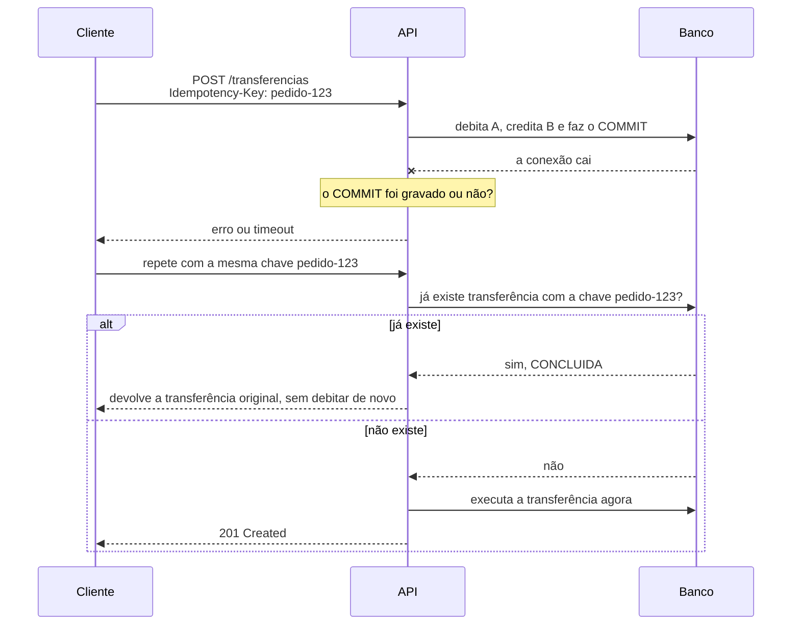
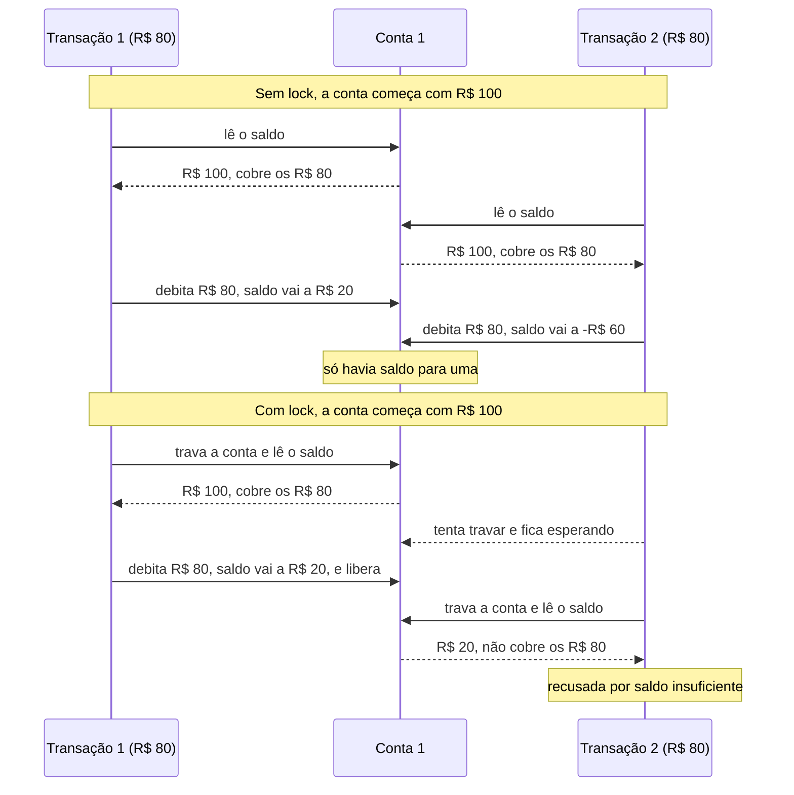

# API de Transferências

Uma API pequena, em Slim 4 e PHP 8.4, que transfere dinheiro entre duas contas fictícias. Ela faz três coisas: transfere, mostra o saldo de uma conta e lista as movimentações dela.

Todo valor é um **inteiro em centavos**: `3000` são R$ 30,00. Não existe vírgula nem arredondamento em lugar nenhum.

O repositório também responde a **questão 2** do case (investigar e corrigir uma falha), num módulo separado da API: veja [Questão 2](#questão-2-investigar-e-corrigir-uma-falha).

## Como rodar

Você só precisa do Docker.

```bash
docker compose up --build
```

Na primeira vez o contêiner roda o `composer install`, então pode levar um minutinho. Quando aparecer `Development Server (http://0.0.0.0:8000) started`, está pronto:

- API: http://localhost:8000
- Swagger: http://localhost:8000/swagger/

Cada subida do contêiner é uma **execução limpa**: o banco é recriado com as contas iniciais. Para voltar ao estado inicial sem derrubar nada:

```bash
docker compose exec api php bin/criar-banco.php
```

## Contas iniciais

| Conta | id | Saldo inicial |
| ----- | -- | ------------- |
| A | `1` | 100000 centavos (R$ 1.000,00) |
| B | `2` | 50000 centavos (R$ 500,00) |

O case fala em "conta A" e "conta B"; aqui elas são identificadas pelos ids numéricos `1` e `2`, seguindo o modelo das tabelas (`id` inteiro).

## Exemplos de requisições

### Transferir R$ 30,00 da conta A para a B

```bash
curl -i -X POST http://localhost:8000/transferencias \
  -H "Content-Type: application/json" \
  -d '{"origem": 1, "destino": 2, "valorCentavos": 3000}'
```

```http
HTTP/1.1 201 Created

{"id":1,"origem":1,"destino":2,"valorCentavos":3000,"status":"CONCLUIDA"}
```

### Consultar o saldo

```bash
curl http://localhost:8000/contas/1
# {"id":1,"saldoCentavos":97000}

curl http://localhost:8000/contas/2
# {"id":2,"saldoCentavos":53000}
```

### Ver as movimentações de uma conta

Lista as transferências em que a conta foi origem ou destino, em ordem de ID.

```bash
curl http://localhost:8000/contas/2/movimentacoes
# [{"id":1,"origem":1,"destino":2,"valorCentavos":3000,"status":"CONCLUIDA"}]
```

### Quando dá errado

Em qualquer erro a resposta tem o mesmo formato, `{"erro": "..."}`, e **nada muda**: nenhum saldo é alterado e nenhuma movimentação é criada.

| Situação | Status | Exemplo de corpo enviado | Resposta |
| -------- | ------ | ------------------------ | -------- |
| Valor zero ou negativo | 400 | `{"origem":1,"destino":2,"valorCentavos":0}` | `O campo valorCentavos deve ser maior que zero.` |
| Valor fracionário ou em texto | 400 | `{"origem":1,"destino":2,"valorCentavos":10.5}` | `O campo valorCentavos deve ser um número inteiro.` |
| Campo ausente | 400 | `{"origem":1,"valorCentavos":3000}` | `O campo destino é obrigatório.` |
| Origem igual ao destino | 400 | `{"origem":1,"destino":1,"valorCentavos":3000}` | `A conta de origem deve ser diferente da conta de destino.` |
| Conta inexistente | 404 | `{"origem":1,"destino":99,"valorCentavos":3000}` | `Conta 99 não encontrada.` |
| Saldo insuficiente | 409 | `{"origem":2,"destino":1,"valorCentavos":999999}` | `Saldo insuficiente para realizar a transferência.` |

`GET /contas/99` e `GET /contas/99/movimentacoes` também respondem 404.

## Testes

```bash
docker compose exec api vendor/bin/pest
```

São 21 casos de teste: sucesso, saldo insuficiente, nove variações de entrada inválida, conta inexistente, ordem do histórico, o comportamento da fila e a retomada pelo worker. Todos conferem os saldos e as movimentações depois da operação, não só o código HTTP. O detalhe de cada cenário está em [`docs/testes`](docs/testes/README.md).

O mesmo comando também roda os 5 testes da [questão 2](#testes-da-questão-2), que ficam em `tests/Questao2`.

## Como a transferência é processada

As tabelas `processamentos` e `falhas_processamento` funcionam como as `jobs` e `failed_jobs` do Laravel. Como o case pede a resposta na hora (201 se transferiu, 409 se faltou saldo), o processamento acontece **dentro da própria requisição**, seguindo o mesmo caminho que um worker seguiria:

1. O `TransferenciaValidator` confere o corpo da requisição (400 se algo estiver errado).
2. O `TransferenciaService` confere se as duas contas existem (404 se não).
3. A transferência é criada como `PENDENTE` e entra na fila (`processamentos`).
4. O processamento é reservado (`tentativas` + 1, `reservado_em`) e a transferência passa a `PROCESSANDO`.
5. Numa **única transação SQL**: confere o saldo, debita a origem, credita o destino, grava a movimentação em `transferencias_contas`, marca `CONCLUIDA` e tira o processamento da fila.
6. Se qualquer coisa falhar no passo 5, a transação é desfeita inteira: a transferência fica `FALHOU` e o processamento vai para `falhas_processamento` com o motivo (409 no caso de saldo insuficiente).

### O worker: retomando o que ficou para trás

Se o processo cai no meio, por timeout ou reinício do contêiner, a transferência fica parada em `PROCESSANDO` e o processamento continua reservado na fila. A transação do passo 5 garante que nenhum saldo fica pela metade, mas nada termina o trabalho. O worker resolve isso, como o `queue:work` do Laravel:

```bash
docker compose exec api sh bin/worker.sh
```

- A cada 5 segundos, o `bin/worker.sh` roda o `bin/processar-fila.php`, que pega os processamentos com a **reserva vencida** (mais de 30 segundos, como o `retry_after` do Laravel) e roda o mesmo processamento da requisição.
- A reserva é condicional: só reserva quem encontra o processamento livre ou vencido. Assim o worker e uma requisição nunca processam o mesmo pedido juntos, e ninguém debita duas vezes.
- Depois de 3 tentativas, desiste: a transferência fica `FALHOU` e o processamento vai para `falhas_processamento` com `Limite de tentativas atingido.`.

A API continua respondendo na hora, porque o case pede 201 ou 409 na resposta. O worker só cuida do que ficou para trás.

Para ver funcionando junto com a idempotência (com ela ligada):

1. Coloque um `throw new \RuntimeException('queda simulada');` logo depois do `atualizarStatus(... Processando)` no `TransferenciaService::processar`, para simular a queda.
2. Faça a transferência com `Idempotency-Key: pedido-123`: a resposta é 500 e a transferência fica `PROCESSANDO`. Repetir a chave agora devolve a transferência parada, sem debitar de novo.
3. Tire o `throw` e suba o worker. Depois de 30 segundos ele mostra `Processamento 1: concluído.`.
4. Repita a requisição com a mesma chave: ela volta `CONCLUIDA`, com origem, destino e valor, e a conta A foi debitada uma vez só.

As tabelas, colunas e relacionamentos estão documentados em [`docs/migrations`](docs/migrations/README.md).

## Escolhas técnicas

- **Slim 4 + PHP-DI.** O container monta as classes sozinho pelo construtor (autowiring), então não há configuração de dependência por classe. A configuração fica em `config/` (container, middlewares e rotas), como num projeto Slim tradicional.
- **Controller → Validator → Service → Repository.** O controller só recebe e responde; o validator cuida da forma da entrada; o service tem as regras (conta existe, saldo cobre, transação); o repository só fala com o banco.
- **PDO puro, sem ORM.** São poucas consultas, e o SQL à vista deixa claro o que acontece com o dinheiro.
- **Centavos em `INTEGER`.** Dinheiro em ponto flutuante perde precisão; inteiro de centavos não.
- **Erros como exceções.** Cada regra quebrada lança uma exceção com o status HTTP (`DadosInvalidosException` 400, `ContaNaoEncontradaException` 404, `SaldoInsuficienteException` 409), e um único `ErroHandler` transforma tudo em `{"erro": "..."}`. Erro inesperado vira 500 com mensagem genérica, e o detalhe vai para o log.
- **Log de requisições.** O `LogRequisicaoMiddleware` (Monolog, PSR-3) grava em `var/logs/requisicoes.log` a rota, o IP, o corpo da requisição, o status e a resposta de cada chamada:

  ```
  [2026-10-31T18:52:13.637179+00:00] requisicoes.INFO: POST /transferencias {"ip":"192.168.65.1","requisicao":{"origem":1,"destino":2,"valorCentavos":3000},"status":201,"resposta":{"id":1,"origem":1,"destino":2,"valorCentavos":3000,"status":"CONCLUIDA"}} []
  ```

- **Swagger.** A especificação OpenAPI está escrita à mão em `public/swagger/openapi.yaml`, e a página em `/swagger/` usa o Swagger UI.

## Persistência: SQLite em memória e a limitação

O banco é SQLite **em memória**, mas com um detalhe importante. No PHP, cada requisição roda num processo novo, e um SQLite `:memory:` morre junto com ela: o `POST` debitaria e o `GET` seguinte voltaria a mostrar 100000.

Por isso o banco é um arquivo dentro de um **tmpfs**, uma pasta montada na RAM pelo `docker-compose.yml`. Ele vive na memória e é compartilhado entre as requisições enquanto o contêiner está de pé. Os testes, que rodam num processo só, usam o `:memory:` de verdade.

A limitação é essa:

- **Os dados somem** quando o contêiner para ou reinicia. É ótimo para o case (toda subida começa limpa) e inaceitável para dinheiro de verdade.
- **Não escala.** É um arquivo local de um único contêiner; duas instâncias da API teriam dois bancos diferentes.
- **Uma escrita por vez.** O SQLite trava o banco inteiro para escrever, o que limita muito o volume de transferências simultâneas.

## Idempotência e concorrência (desativadas)

O case não exige essas duas partes, então elas estão no código **comentadas**, prontas para ligar. Basta descomentar os trechos marcados com `Idempotência (desativada)` ou `Concorrência (desativada)`.

### Idempotência

Cobre o usuário que clica duas vezes em "transferir", ou o front que recebe timeout e repete a requisição. O cliente manda uma chave no cabeçalho `Idempotency-Key`; se a mesma chave chegar de novo, a API devolve o resultado da primeira requisição **sem debitar e creditar outra vez**: a transferência original ou, se ela falhou, o mesmo 409.

Para ligar, descomente três trechos:

1. `TransferenciaController::criar`: o repasse do cabeçalho `Idempotency-Key`.
2. `TransferenciaService::transferir`: o bloco que procura a transferência pela chave.
3. `TransferenciaRepository::buscarPorIdempotencia`: a consulta.

```bash
# as duas chamadas devolvem a mesma transferência (id 1) e a conta A é debitada uma vez só
curl -X POST http://localhost:8000/transferencias -H "Content-Type: application/json" \
  -H "Idempotency-Key: pedido-123" -d '{"origem": 1, "destino": 2, "valorCentavos": 3000}'
```

A coluna `transferencia.idempotencia` é `UNIQUE`. Se duas requisições com a mesma chave chegarem exatamente juntas, as duas podem consultar e não achar nada, mas o banco só deixa uma gravar: a outra recebe erro e nunca vira uma segunda transferência.

### Concorrência

Cobre duas transferências simultâneas saindo da mesma conta. Sem controle, as duas podem ler o mesmo saldo antes de qualquer uma debitar.

O SQLite não tem `SELECT ... FOR UPDATE`. O equivalente aqui é fazer uma escrita na conta de origem logo no começo da transação, o que pega o bloqueio de escrita do banco. A segunda transferência espera a primeira terminar e só então lê o saldo, já atualizado.

Para ligar, descomente dois trechos:

1. `TransferenciaService::debitarECreditar`: a chamada `bloquearParaAtualizacao`.
2. `ContaRepository::bloquearParaAtualizacao`: o método.

Testei isso disparando duas transferências de 30000 ao mesmo tempo da conta B, que tem 50000:

| | Resultado |
| - | --------- |
| Sem o bloqueio | As duas falham com 500 (`database is locked`): o SQLite percebe o impasse e derruba as duas. O saldo não fica errado, mas até a transferência que cabia no saldo é perdida. |
| Com o bloqueio | Uma conclui (201) e a outra recebe 409. Saldo final: 20000. |

O servidor embutido do PHP atende uma requisição por vez, então no `docker compose up` normal essa corrida nem acontece. Para reproduzi-la, suba o servidor com `PHP_CLI_SERVER_WORKERS=4`.

## O que eu melhoraria para uso real

- **Banco de verdade** (PostgreSQL ou MySQL), com `SELECT ... FOR UPDATE` no lugar do bloqueio do SQLite, índices em `conta_origem_id` e `conta_destino_id` e migrations versionadas (Phinx ou Doctrine Migrations).
- **Fila assíncrona de verdade:** um worker separado (Redis, RabbitMQ ou SQS), o `POST` respondendo 202 com o ID e um `GET /transferencias/{id}` para o cliente acompanhar o status, com novas tentativas e espera crescente entre elas.
- **Idempotência ligada e completa:** guardar a resposta original com prazo de validade e, quando duas requisições com a mesma chave chegarem juntas, devolver a transferência original à segunda em vez de erro.
- **Livro-razão (dupla entrada):** um lançamento de débito e um de crédito por transferência, com o saldo calculado a partir deles. Fica fácil auditar e conciliar.
- **Segurança:** autenticação, autorização (só o dono movimenta a conta) e limite de requisições.
- **Paginação** no histórico de movimentações.
- **Nginx + PHP-FPM** no lugar do servidor embutido do PHP, que é só para desenvolvimento.
- **Observabilidade:** um id de correlação por requisição, rotação dos logs, dados sensíveis mascarados, métricas e alertas.

## Questão 2: investigar e corrigir uma falha

A segunda questão do case traz um serviço de transferência com estado em memória, sem transação, que perde dinheiro quando a conta de destino está bloqueada. O código dela fica separado da API, em `src/Questao2`, com testes próprios em `tests/Questao2`. Nada da questão 1 mudou: rotas, respostas e testes continuam iguais.

### O problema

Conta A com 10000 centavos, conta B com 5000 e bloqueada, transferência de 3000 de A para B. O serviço devolve erro, mas termina com A = 7000 e B = 5000: os 3000 centavos somem. O esperado era A = 10000 e B = 5000, sem movimentação.

### A causa

O serviço confere o valor e o saldo da origem, debita a origem e só depois chama `creditar`, que é onde o bloqueio do destino é verificado:

```
transferir(origem, destino, valor):
    se valor <= 0: falhar("valor inválido")
    se origem.saldo < valor: falhar("saldo insuficiente")
    origem.saldo = origem.saldo - valor        ← A já perdeu os 3000
    creditar(destino, valor)                   ← falha aqui: B está bloqueada
    registrarMovimentacao(origem, destino, valor)
```

Como não há transação, nada desfaz o débito quando `creditar` lança a exceção. A operação é interrompida no meio: a origem já foi debitada, o destino nunca é creditado e a movimentação nunca é registrada.

### A correção

A correção tem duas partes, que se completam:

1. **Validar o destino antes de mexer em qualquer saldo.** O bloqueio passa a ser conferido junto com as outras validações. É o que resolve o cenário do case: a transferência para B bloqueada para antes da primeira alteração.
2. **Transação em memória com rollback.** Débito, crédito e registro rodam juntos num `try/catch`. Os saldos são guardados antes e, se qualquer passo falhar, eles voltam ao que eram. A validação cuida da falha conhecida; a transação garante o tudo-ou-nada também para as falhas que ninguém previu.

```diff
  if ($origem->saldoCentavos < $valorCentavos) {
      throw new SaldoInsuficienteException();
  }

+ if ($destino->bloqueada) {
+     throw new ContaBloqueadaException($destino->id);
+ }
+
+ $saldoOrigem = $origem->saldoCentavos;
+ $saldoDestino = $destino->saldoCentavos;
+
+ try {
      $origem->debitar($valorCentavos);
      $destino->creditar($valorCentavos);
      $this->movimentacaoRepository->registrar($origem->id, $destino->id, $valorCentavos);
+ } catch (Throwable $erro) {
+     $origem->restaurarSaldo($saldoOrigem);
+     $destino->restaurarSaldo($saldoDestino);
+
+     throw $erro;
+ }
```

O erro não é engolido em nenhuma das partes: a validação lança `ContaBloqueadaException` e o rollback relança o erro original depois de restaurar os saldos. A diferença é que nenhuma alteração fica para trás. O `Conta::creditar` mantém a própria verificação, então a entidade continua recusando crédito em conta bloqueada, venha a chamada de onde vier.

| Arquivo em `src/Questao2` | O que é |
| ------------------------- | ------- |
| `Entity/Conta.php` | A conta em memória: `id`, `saldoCentavos` e a nova flag `bloqueada`. O `restaurarSaldo` é usado pelo rollback. |
| `Service/TransferenciaOriginalService.php` | O pseudocódigo do case traduzido como veio, **com a falha**. Fica no projeto só para o teste reproduzir o problema. |
| `Service/TransferenciaService.php` | A versão corrigida: validação do destino e transação com rollback. |
| `Repository/MovimentacaoRepository.php` | Guarda as movimentações num array. |
| `Exceptions/ContaBloqueadaException.php` | O erro de conta bloqueada. |

As validações de valor e de saldo reaproveitam as exceções da questão 1 (`DadosInvalidosException` e `SaldoInsuficienteException`). A flag também ganhou uma coluna na tabela `contas` ([migration 006](docs/migrations/006_adicionar_coluna_bloqueada_em_contas.md)), com padrão `0`. A API da questão 1 não lê essa coluna, então continua igual.

### Testes da questão 2

```bash
docker compose exec api vendor/bin/pest tests/Questao2
```

Todos transferem de A (10000) para B (5000, salvo onde indicado). Os dois primeiros são o mesmo cenário rodando nos dois serviços, o que mostra a falha e a correção lado a lado:

| Cenário | Serviço | Resultado |
| ------- | ------- | --------- |
| Falha original: B bloqueada, 3000 | original | Erro, com A = 7000, B = 5000 e nenhuma movimentação. É a falha reproduzida. |
| Correção: B bloqueada, 3000 | corrigido | Erro, com A = 10000, B = 5000 e nenhuma movimentação. |
| Rollback: B com saldo no limite do inteiro (`PHP_INT_MAX`), 3000 | corrigido | O crédito estoura e o PHP lança `TypeError`, uma falha que a validação não prevê. A transação devolve o débito: A = 10000, B sem alteração e nenhuma movimentação. Sem o rollback, A terminaria com 7000. |
| Sucesso: B desbloqueada, 3000 | corrigido | A = 7000, B = 8000 e uma movimentação registrada. |
| Saldo insuficiente: 10001 | corrigido | Erro, com A = 10000, B = 5000 e nenhuma movimentação. |

### Por que essa correção não prova segurança contra falha de banco nem requisições simultâneas

O exercício propõe solucionar um problema específico, mas existem outros cenários de falhas que podem ser considerados questões externas à implementação, como falhas no banco de dados e requisições simultâneas.

Para esta questão, conseguimos tratar apenas a atomicidade das operações em memória que compõem a transação, garantindo também uma ordem segura de execução dessas operações.

Exemplo: se alguma validação falhar, nenhuma alteração nos saldos é realizada, pois todas as validações acontecem antes das operações de débito e crédito. Dessa forma, evitamos que uma falha deixe os saldos inconsistentes. Na resolução, garanti que o destino fosse validado antes de debitar o saldo da origem.

#### Falha no banco de dados

A correção desse exemplo não prova segurança diante de falhas no banco de dados, pois, durante todo esse processo, podem acontecer alguns cenários, como o banco de dados ficar indisponível durante o `COMMIT` de uma gravação ou a aplicação perder a conexão com o banco de dados, ficando sem saber se aqueles dados foram realmente persistidos nas tabelas.

Podemos lidar com esses cenários utilizando a idempotência, garantindo que o usuário possa realizar novamente a mesma solicitação de transferência com segurança, sem correr o risco de duplicar uma operação que já tenha sido efetivada. Para isso, é necessário utilizar um identificador único para cada operação e consultar seu estado antes de tentar executá-la novamente.



#### Requisições simultâneas

Também não resolve o problema de requisições simultâneas, pois, no que foi desenvolvido, não existe nenhum mecanismo que garanta que, ao receber várias requisições, a aplicação não utilize um saldo desatualizado durante o processamento de operações simultâneas.

Exemplo:

Conta 1 possui R$ 100,00.

- Transação 1 → 10:12:00 → Conta 1 realiza uma transferência de R$ 80,00.
- Transação 2 → 10:12:00 → Conta 1 realiza outra transferência de R$ 80,00.

Durante o processamento das transações, pode acontecer de ambas consultarem o saldo de R$ 100,00, considerando que esse seja o saldo correto da conta. Assim, as duas podem entender que existe saldo suficiente para realizar a transferência, mesmo que estejam processando operações simultaneamente.

Esse problema é conhecido como condição de corrida (_Race Condition_).

Para mitigar esse problema, pode ser criado um lock no banco de dados ou em memória, garantindo que uma transação aguarde a outra terminar de processar antes de iniciar uma operação que possa afetar o mesmo saldo.



A API da questão 1 já traz essas duas proteções prontas para ligar: veja [Idempotência e concorrência](#idempotência-e-concorrência-desativadas).

## Estrutura do projeto

```
├── bin/
│   ├── criar-banco.php        cria as tabelas e as contas iniciais
│   ├── processar-fila.php     processa uma vez o que ficou para trás na fila
│   └── worker.sh              roda o processar-fila.php a cada 5 segundos
├── config/                    container (PHP-DI), middlewares e rotas
├── database/                  schema.sql e seed.sql
├── docs/
│   ├── migrations/            tabelas, colunas e relacionamentos
│   └── testes/                cenários de teste
├── public/
│   ├── index.php              entrada da API
│   └── swagger/               página e especificação OpenAPI
├── src/
│   ├── Controller/            recebem a requisição e devolvem JSON
│   ├── Database/              conexão e criação do banco
│   ├── Enum/                  status da transferência
│   ├── Exceptions/            erros de negócio com o status HTTP
│   ├── Handler/               transforma exceções em resposta JSON
│   ├── Http/                  resposta JSON compartilhada
│   ├── Middleware/            log de requisições
│   ├── Questao2/              módulo da questão 2 (transferência em memória)
│   ├── Repository/            acesso ao banco (PDO)
│   ├── Service/               regras de negócio
│   └── Validation/            validação da entrada
├── tests/
│   ├── Feature/               testes Pest da API
│   └── Questao2/              testes da questão 2
└── var/logs/requisicoes.log   log de requisições
```
