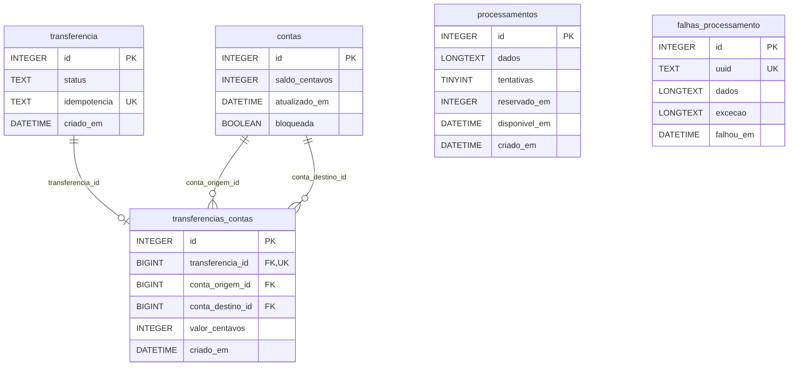

# Migrations

O Slim não tem migrations como o Laravel, então esta pasta documenta as tabelas do jeito que uma migration documentaria: o que cada uma guarda, suas colunas, regras e relacionamentos.

O SQL que realmente roda fica em [`database/schema.sql`](../../database/schema.sql) (estrutura) e [`database/seed.sql`](../../database/seed.sql) (contas iniciais). Os dois são executados pelo `bin/criar-banco.php` sempre que o contêiner sobe.

## Ordem

| # | Arquivo | Tabela |
| - | ------- | ------ |
| 1 | [001_criar_tabela_contas.md](001_criar_tabela_contas.md) | `contas` |
| 2 | [002_criar_tabela_transferencia.md](002_criar_tabela_transferencia.md) | `transferencia` |
| 3 | [003_criar_tabela_transferencias_contas.md](003_criar_tabela_transferencias_contas.md) | `transferencias_contas` |
| 4 | [004_criar_tabela_processamentos.md](004_criar_tabela_processamentos.md) | `processamentos` |
| 5 | [005_criar_tabela_falhas_processamento.md](005_criar_tabela_falhas_processamento.md) | `falhas_processamento` |
| 6 | [006_adicionar_coluna_bloqueada_em_contas.md](006_adicionar_coluna_bloqueada_em_contas.md) | `contas` (questão 2) |

## Relacionamentos

- Uma `transferencia` tem no máximo uma linha em `transferencias_contas`. Ela só é criada quando o débito e o crédito dão certo; por isso a transferência que falhou não tem movimentação.
- `processamentos` e `falhas_processamento` não têm chave estrangeira, como as jobs do Laravel: a ligação com a transferência fica no JSON da coluna `dados` (`transferenciaId`).

## Tipos no SQLite

O SQLite não tem tipos rígidos, ele trabalha com afinidade. Os tipos do planejamento foram mantidos sempre que o SQLite aceita:

| Planejado | No schema | Por quê |
| --------- | --------- | ------- |
| `BigInt` (PK) | `INTEGER PRIMARY KEY` | É o único jeito de o SQLite gerar o id sozinho. O `INTEGER` dele já tem 64 bits, o mesmo alcance do `BIGINT`. |
| `BigInt` (FK) | `BIGINT` | Aceito como está (afinidade inteira). |
| `Decimal(15,2)` | `INTEGER` | Os valores são centavos inteiros: 3000 = R$ 30,00. Sem casas decimais, sem arredondamento. |
| `enum` | `TEXT` + `CHECK` | O SQLite não tem enum; o `CHECK` recusa qualquer status fora da lista. |
| `Boolean` | `BOOLEAN` + `CHECK` | O SQLite guarda como inteiro; o `CHECK` só aceita `0` ou `1`. |
| `TINYINT`, `LONGTEXT`, `DATETIME` | iguais | Aceitos como estão. As datas são gravadas em texto ISO (`2026-10-31 18:52:57`), em UTC. |

As chaves estrangeiras só valem no SQLite com `PRAGMA foreign_keys = ON`, que é ligado em toda conexão (`src/Database/BancoDeDados.php`).
